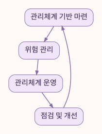

안녕하세요~ ☺️

기업에서는 고객의 개인정보부터 서비스 소스코드, 서버, 데이터베이스 등 다양한 정보자산을 관리하고 있는데요.

이러한 정보자산을 안전하게 보호하기 위해 기업에서는 어떤 기준을 따르고 있을까요?

이번 글에서는 국내 정보보호 인증제도인 **ISMS-P**와 기업의 정보보호 관리 방식에 대해 정리해보려고 합니다!

## 목차

- [01. ISMS-P란?](#section-01)
    - [01-1. ISMS와 ISMS-P의 차이](#section-01-1)
- [02. ISMS-P 인증 기준](#section-02)
    - [02-1. 인증 심사의 종류](#section-02-1)
- [03. 국내외 정보보호 인증 및 표준](#section-03)
- [04. 정보보호 관리체계는 어떻게 운영될까?](#section-04)
    - [04-1. 정보자산 식별](#section-04-1)
- [05. 12가지 보호대책 요구사항](#section-05)
    - [05-1. 인증(Authentication)과 인가(Authorization)](#section-05-1)
    - [05-2. IAM](#section-05-2)
    - [05-3. MFA](#section-05-3)
- [06. 개인정보 처리 단계별 보호](#section-06)
    - [06-1. 실제 개인정보 처리방침 사례](#section-06-1)
- [07. 마무리](#section-07)

## 01. ISMS-P란? {#section-01}

먼저 각각 어떤 단어의 약자인지 알아보겠습니다!

- **ISMS (Information Security Management System)**: 정보보호 관리체계
- **ISMS-P (Personal Information & Information Security Management System)**: 정보보호 및 개인정보보호 관리체계

ISMS-P는 기업이나 기관이 정보보호 및 개인정보보호 활동을 체계적으로 수행하고 있는지 평가하고 인증하는 제도입니다.

예를 들어 온라인 쇼핑몰을 운영하는 기업에는 다음과 같은 정보자산이 존재합니다.

- 웹 서버 및 데이터베이스
- 고객의 이름, 전화번호, 배송지
- 서비스 소스코드
- 직원 및 관리자 계정

기업에서는 이러한 자산들을 보호하기 위해 보안 정책을 수립하고 지속적으로 관리해야 합니다.

### 01-1. ISMS와 ISMS-P의 차이 {#section-01-1}

| 구분 | ISMS | ISMS-P |
| --- | --- | --- |
| 정보보호 관리체계 | O | O |
| 정보보호 보호대책 | O | O |
| 개인정보 처리 단계별 요구사항 | 별도 심사 영역 없음 | O |
| 예시 | 서버 접근 권한 관리 | 고객 개인정보 수집부터 파기까지 관리 |

ISMS-P는 ISMS의 인증 기준에 개인정보 처리 단계별 보호 요구사항이 추가된 형태라고 이해하시면 됩니다.

## 02. ISMS-P 인증 기준 {#section-02}

ISMS-P의 인증 기준은 크게 세 가지 영역으로 구성되어 있습니다.

1. **관리 체계 수립 및 운영**: 정보보호 정책 수립 및 관리
2. **보호대책 요구사항**: 정보자산을 보호하기 위한 구체적인 보안 조치
3. **개인정보 처리 단계별 요구사항**: 개인정보 수집부터 파기까지의 관리

### 02-1. 인증 심사의 종류 {#section-02-1}

| 구분 | 설명 |
| --- | --- |
| 최초 심사 | 처음으로 인증을 받기 위한 심사 |
| 사후 심사 | 인증 이후에도 관리체계가 유지되는지 확인 |
| 갱신 심사 | 인증 유효기간 만료에 따른 심사 |

인증을 받은 이후에도 정보보호 관리체계를 지속적으로 유지해야 합니다.

## 03. 국내외 정보보호 인증 및 표준 {#section-03}

ISMS-P 외에도 보호 대상과 목적에 따라 다양한 인증 및 표준이 존재합니다.

| 인증 및 표준 | 주요 내용 |
| --- | --- |
| ISMS-P | 국내 정보보호 및 개인정보보호 관리체계 |
| ISO 27001 | 국제 정보보호 관리체계 표준 |
| ISO 27017 | 클라우드 환경의 정보보호 |
| ISO 27018 | 퍼블릭 클라우드 환경의 개인정보보호 |
| ISO 27701 | 개인정보보호 관리체계 |
| CSA STAR | 클라우드 서비스의 보안 수준 평가 |
| PCI DSS | 결제 카드 데이터 보호 |

## 04. 정보보호 관리체계는 어떻게 운영될까? {#section-04}

관리체계의 수립 및 운영은 크게 네 단계로 구성됩니다.

<!-- 도표 원본: /assets/posts/isms-p/management-cycle.mmd -->

| 단계 | 설명 | 예시 |
| --- | --- | --- |
| 관리체계 기반 마련 | 보안 정책 및 담당자 설정 | 보안팀 구성 |
| 위험 관리 | 정보자산에 대한 위험 파악 및 평가 | 개인정보 유출 위험 분석 |
| 관리체계 운영 | 수립한 보안 정책 적용 | 관리자 MFA 적용 |
| 점검 및 개선 | 운영 상태 확인 및 개선 | 정기 보안 점검 |

이러한 과정을 지속적으로 반복하며 기업의 보안 수준을 유지하고 개선합니다.

### 04-1. 정보자산 식별 {#section-04-1}

정보자산은 기업에서 보호할 가치가 있는 정보, 시스템, 소프트웨어 등을 의미합니다.

기업에서는 관리 대상인 정보자산의 종류, 위치, 담당자, 중요도 등을 파악하고 이를 **정보자산관리대장**으로 관리할 수 있습니다.

무엇을 보호해야 하는지 알아야 그에 맞는 보안 정책도 수립할 수 있기 때문입니다!

## 05. 12가지 보호대책 요구사항 {#section-05}

정보자산을 보호하기 위해 기업에서는 다음과 같은 보안 조치를 수행합니다.

| 항목 | 적용 예시 |
| --- | --- |
| 2.1 정책, 조직, 자산 관리 | 보안 정책 수립, 정보자산관리대장 작성 |
| 2.2 인적 보안 | 직원 보안 교육 |
| 2.3 외부자 보안 | 외주업체 접근 권한 관리 |
| 2.4 물리 보안 | 서버실 출입 통제 |
| 2.5 인증 및 권한 관리 | IAM, MFA |
| 2.6 접근 통제 | 방화벽, IP 제한 |
| 2.7 암호화 적용 | HTTPS, 데이터 암호화 |
| 2.8 정보시스템 도입 및 개발 보안 | 시큐어 코딩 |
| 2.9 시스템 및 서비스 운영관리 | 로그 및 백업 관리 |
| 2.10 시스템 및 서비스 보안관리 | 서버 보안 설정 |
| 2.11 사고 예방 및 대응 | 취약점 점검, 침해사고 대응 |
| 2.12 재해 복구 | 백업 및 복구 계획 수립 |

이 중 인증, 권한 관리, 접근 통제와 관련된 개념을 조금 더 자세히 알아보겠습니다.

### 05-1. 인증(Authentication)과 인가(Authorization) {#section-05-1}

인증과 인가는 보안에서 기본이 되는 개념입니다.

- **인증**: 사용자가 누구인지 확인하는 과정
- **인가**: 해당 사용자에게 어떤 권한이 있는지 확인하는 과정

학교 포털을 예시로 들어보겠습니다.

| 상황 | 구분 |
| --- | --- |
| 학번과 비밀번호를 입력해 로그인 | 인증 |
| 학생이 자신의 성적을 열람 | 인가 |
| 교수가 학생의 성적을 입력 | 인가 |
| 권한이 없는 학생의 성적 수정 요청을 차단 | 접근 통제 |

### 05-2. IAM {#section-05-2}

**Identity and Access Management (자격 증명 및 접근 관리)**

사용자의 신원과 접근 권한을 관리하는 체계입니다.

예를 들어 개발자에게 서버 설정을 확인할 수 있는 권한만 부여하고, 서버를 생성하거나 삭제할 수 있는 권한은 제한할 수 있습니다.

이처럼 업무에 필요한 만큼의 권한만 부여하는 것을 **최소 권한 원칙(Least Privilege Principle)**이라고 합니다.

### 05-3. MFA {#section-05-3}

**Multi-Factor Authentication (다중 요소 인증)**

서로 다른 종류의 인증 요소를 두 가지 이상 사용하는 인증 방식입니다.

| 인증 요소 | 설명 | 예시 |
| --- | --- | --- |
| 지식 기반 | 사용자가 알고 있는 것 | 비밀번호, PIN |
| 소유 기반 | 사용자가 가지고 있는 것 | 스마트폰, 보안 토큰 |
| 생체 기반 | 사용자의 신체적 특징 | 지문, 얼굴 인식 |

비밀번호가 유출되더라도 추가적인 인증 요소를 통해 계정을 보호할 수 있습니다.

## 06. 개인정보 처리 단계별 보호 {#section-06}

기업은 개인정보를 수집하는 시점부터 이용하고 보관하다가 파기하는 시점까지 안전하게 관리해야 합니다.

기업이 개인정보를 어떤 방식으로 처리하는지 확인할 수 있는 대표적인 문서가 **개인정보 처리방침**입니다.

### 06-1. 실제 개인정보 처리방침 사례 {#section-06-1}

실제 서비스를 이용하면서 개인정보 처리방침을 자세히 읽어보신 적 있으신가요?

다음은 참고할 수 있는 기업별 개인정보 처리방침 사례입니다.

- **네이버**
- **오늘의집**
- **11번가**

각 기업의 개인정보 처리방침에서 다음과 같은 내용을 확인해 보시면 좋을 것 같습니다!

- 수집하는 개인정보 항목 및 수집 목적
- 개인정보 보유 및 이용 기간
- 개인정보의 제3자 제공
- 개인정보 처리 위탁
- 개인정보 파기 절차 및 방법
- 이용자의 권리 및 행사 방법

같은 개인정보 처리방침이라도 서비스의 특성에 따라 수집하는 정보나 관리 방식이 달라질 수 있습니다.

## 07. 마무리 {#section-07}

이번 글에서는 ISMS-P 인증제도와 기업의 정보보호 관리체계에 대해 정리해봤습니다!

정보보호에는 기술적인 보안 조치와 함께 보안 정책, 인적 관리, 위험 관리 등 다양한 관리 활동이 필요합니다.

그렇다면 이러한 정보보호 기준을 클라우드 환경에서는 어떻게 적용할까요?

다음 글에서는 AWS 클라우드 환경을 예시로 다양한 보안 기술과 서비스에 대해 알아보겠습니다!

---

**이전 글 / 다음 글**

[다음 글 → 02 AWS 클라우드에서의 정보보호]()
